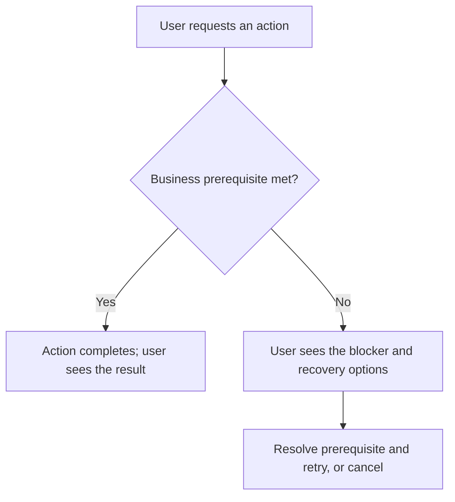

# Sprint 0 Admission Gate: Product Discovery

## Purpose and Boundary

Require a business-owned evidence packet and an explicit go/no-go decision before starting Sprint 0 for a new epic or materially changed epic scope.

An idea, a meeting invitation, or a request to "work it out in Sprint 0" is not sufficient. A short intake or evidence-building discussion is discovery preparation, not the start of Sprint 0.

> Admission establishes a believable intended experience. Sprint 0 challenges and refines that experience through domain modeling, architecture, and delivery enablement.

This gate does not require final screens, a complete product specification, approved ontology, aggregates, API contracts, or implementation issues. Those are not substitutes for business intent either.

Preserve the two-week timebox and all design, operational, identity, deployment, and backlog outcomes in the [Sprint 0 methodology](sprint-0-basic-overview.md). Follow the [Sprint 0 process](sprint-0-process.md) after admission. This gate does not retroactively require a packet for every existing feature or bug fix; re-review is required when the admitted outcome, constraints, or scope materially change.

## Ownership

| Role | Responsibility |
|---|---|
| Business/Product Owner | Supplies the packet; owns the opportunity, intended value, scope, and business decisions |
| Experience Contributor/Reviewer | Helps build and reviews journeys, flows, and visual evidence where interaction is material |
| Engineering Reviewer | Checks plausibility against architecture, relevant code/APIs, constraints, dependencies, and ownership |
| Admission Decision Owner | Named accountable approver who records GO or NO-GO for the exact proposed scope after considering review findings |
| Developer or AI agent | Helps structure evidence and surface gaps; does not invent business approval or admit work on behalf of the decision owner |

One person may perform more than one role, but the packet must identify who performs each applicable role. Agree who will own canonical language during Sprint 0. Engineering facilitation does not transfer business accountability to engineering.

## Required Evidence

One packet with sections and links is sufficient. Do not create a separate document for every row.

| Evidence | Minimum acceptable content | Not sufficient |
|---|---|---|
| Opportunity and outcome | Problem or strategic opportunity, intended improvement, customer-visible value, success evidence | A solution name or technology choice alone |
| People and scope | Primary actor, beneficiaries, stakeholders, accountable owners, included/excluded scope | "All users" without a representative actor or scenario |
| Representative journey | Starting situation, trigger, meaningful steps, outcome, and relevant handoffs | A list of screens or storage entities |
| Experience flow | A readable user, business, administrative, or system flow, including a material exception and recovery/terminal outcome | Only a happy-path sentence |
| Basic use cases | Main success scenario and at least one material alternate/failure scenario, where applicable; actor, preconditions, trigger, steps, result | Feature titles without observable behavior |
| Visual evidence | For materially new or uncertain UI, sketches, wireframes, mockups, or a prototype showing the main interaction and important states | An unannotated inspiration image or infrastructure diagram |
| Established/nonvisual experience | For established UI, referenced screenshots/flows annotated with intended changes; for nonvisual work, a justified UI-not-applicable statement and business/system flow | Silently omitting the experience evidence |
| Rules and constraints | Known consequential rules, important states, exceptions, dependencies, and decisions | Unresolved product policy hidden as a technical detail |
| Evidence and assumptions | Supporting observations/research separated from assumptions, with source references | An assumption presented as a verified fact |
| Feasibility and responsibility | Lightweight capability assessment, evidence, constraints, expected owners, and material unknowns | "The platform will do it" without evidence or owner review |
| Questions and focused scope | Pre-entry blockers, accepted Sprint 0 questions, deferred scope, and a coherent portion to investigate first | An unbounded epic with all decisions left open |
| Admission record | Checklist results, reviewer findings, exact scope/revision, decision, owner, date, and rationale | A completed template with no approval |

If a scenario or state is genuinely not applicable, record why and obtain reviewer agreement. Missing required evidence cannot be relabeled as accepted uncertainty.

## How to Build the Packet

### 1. Frame the Opportunity

The Business/Product Owner describes the problem, who experiences it, what becomes better, and what is deliberately excluded. Identify success evidence, preferably a measurable outcome with a baseline or an explicit plan to establish one.

Gather applicable product strategy, research, previous decisions, commercial/entitlement constraints, identity/access, privacy, security, regulatory, retention, business-policy, and external-platform constraints. Link approved sources; distinguish evidence from assumptions.

Use the existing [product overview](../product/sprint-0/overview.md) and [ontology](../product/sprint-0/ontology.md) for context. Reuse established meanings; record candidate terms and ambiguities without prematurely finalizing new ontology.

### 2. Walk a Representative Experience

Ask the actor or business representative to walk through one concrete scenario:

1. What situation exists before the work starts?
2. What triggers it, and who acts?
3. What happens next, including human/system handoffs?
4. What result does the actor see or receive?
5. What can prevent success, and what happens then?
6. What can the actor do to recover, return, or finish safely?

Record a concise journey and success/alternate use cases. A single flow can also represent the journey when it covers the necessary information; do not duplicate it for formatting alone.

Embed a Mermaid flowchart or sequence diagram in the product packet when useful, or reference a readable exported flow. Use plain business/user language rather than controllers, DTOs, tables, or final domain commands.

Example only: a business flow with a material failure path.



Capture recognizable candidate business events in past tense, such as "Configuration was completed" or "Execution failed." These are discovery observations, not an approved domain-event model. Do not start formal Event Storming before the [ontology prerequisite](sprint-0-step-2-event-storming.md) is satisfied.

### 3. Make the Experience Visible

Use [information architecture](../product/sprint-0/information-architecture.md) and the [UX foundation](../product/sprint-0/ux-foundation.md) before choosing page/component details. Apply the [administrative UX guide](style-guide-admin.md) only to administrative surfaces.

For new or uncertain UI, sketch the primary interaction first, then annotate:

- Page purpose, information hierarchy, navigation, important data, and primary/secondary actions.
- Material states and business-rule consequences.
- Validation, blocked actions, dependency failures, partial success, and recovery.
- Drill-down and return paths, where relevant.

Consider empty, loading, initial/unconfigured, pending, configured, active/inactive, unauthorized, entitlement/capacity-blocked, failed, and archived/retired states. Include those material to the proposed scope, not every possible screen.

Use a compact state matrix:

| State | Trigger | User sees or receives | Available action/recovery | Governing rule |
|---|---|---|---|---|
| Describe a material state | What causes it | Visible information or system result | What can happen next | Business rule or decision reference |

Fidelity must be proportional to uncertainty. Basic annotated mockups are sufficient when reviewers can challenge the experience. Use high-fidelity graphical mockups when layout, interaction, or business decisions cannot be evaluated reliably at lower fidelity; production UI code is not required.

Review the evidence against four questions:

1. Is the experience valuable?
2. Is it understandable and usable?
3. Is it plausible with the product/platform, or are gaps explicit?
4. Does it support the intended product strategy and applicable commercial constraints?

### 4. Expose Rules and Decisions

Record known rules affecting identity, authorization, entitlement/licensing, lifecycle, ownership, retention, aggregation, immutability, failure, security, and evidence/provenance where applicable.

Separate open questions from resolved decisions. Use the existing [intent-gap register](../product/features/intent-gap-register.md) for unresolved product/technical intent, with an owner and links to the affected packet and closure evidence. Do not invent a second central decision system. Keep resolved decisions and rationale in the related product document and link to them from the register.

For each question, record its consequence, current recommendation, owner, affected scope, and one disposition:

| Disposition | Treatment |
|---|---|
| Blocking before Sprint 0 | Resolve and record closure evidence before admission |
| Accepted uncertainty for Sprint 0 | Explain why it does not prevent coherent discovery; identify owner, investigation, and affected slice |
| Deferred | Exclude the dependent behavior from admitted scope and state when it must be reconsidered |

Example only: whether partial activation is permitted is a product-policy question to settle before admitting activation scope. Which aggregate protects that rule is an appropriate Sprint 0 modeling question.

### 5. Check Plausibility and Ownership

The Engineering Reviewer inspects only enough relevant architecture, code, APIs, tests, and approved external contracts to assess plausibility. Do not implement the capability as part of this review.

| Capability | Status | Evidence and constraints | Expected owner / dependency |
|---|---|---|---|
| Capability needed by the experience | Exists / Partial / Product New / Platform Gap / Unknown / Deferred | Code/API/test/document reference; observed support, limitations, and uncertainty | Product, platform, or external authority; agreement or unresolved ownership |

- **Exists:** evidence supports the intended behavior, not merely a similarly named type.
- **Partial:** existing support needs extension or adaptation.
- **Product New:** new work appears to belong in this product.
- **Platform Gap:** shared responsibility is proposed but missing; it does not commit another team.
- **Unknown:** evidence is insufficient; identify the investigation and whether it blocks admission.
- **Deferred:** the dependent outcome is outside the proposed admission scope.

Review relevant entities/value objects, application flows, services/APIs, access controls, integrations, orchestration, metadata, and read needs without prescribing the final model. Make external data authority and adaptation expectations visible.

Current code is evidence of feasibility, not automatic product truth. Do not rename intended concepts just to match current code. An unknown may enter Sprint 0 only when reviewers explain why coherent modeling is still plausible; a fundamental unresolved feasibility or ownership blocker is NO-GO.

### 6. Assemble and Submit

Store the packet as product truth in [product feature documentation](../product/features/), for example `epic-<name>.md`, or extend/link an existing product document that already owns the initiative. Do not redefine a Feature as an Epic or copy an existing feature's full narrative. Link shared [user flows](../product/sprint-0/user-flows.md) rather than copying them.

Keep editable visual sources and readable exports alongside the owning product packet when local assets are needed; no separate asset hierarchy is required. Use descriptive lowercase-hyphen names containing the epic, view, and revision, such as `epic-example-overview-v1.png`. A proposed filename is not a requirement to use a new tool or file type.

Reference the exact source/export revision and mark it Draft, Reviewed, or Superseded in the product Markdown. Approved collaboration-tool sources may be linked, but the packet must contain or link reviewer-accessible evidence identifying what was reviewed; a mutable workspace link alone is not an admission record.

Follow the [canonical repository authoring workflow](sprint-0-tools.md), [documentation conventions](style-guide.md), and [AI/data policy](ai-policy.md). Use sanitized or synthetic examples and do not place secrets or prohibited personal data in packets, screenshots, mockups, or review evidence.

## Reusable Epic Packet Outline

Copy these headings into the owning product document and fill them using the evidence-building steps above. Reference existing artifacts rather than reproducing them.

```markdown
# Epic Definition: <name>

## Opportunity
## Intended Outcome and Customer-Visible Value
## People, Users, and Accountable Owners
## Experience Intent
## Representative Journey and Experience Flow
## Basic Use Cases
### Main Success Scenario
### Material Alternate/Failure Scenario and Recovery
## UX Evidence and Material State Matrix
## Candidate Business Events
## Business Rules and Constraints
## Evidence and Assumptions
## Existing Capability / Feasibility
## Product / Platform Responsibility
## Resolved Decisions
## Open Questions
### Blocking Before Sprint 0
### Accepted Uncertainty for Sprint 0
### Deferred
## Scope
### In Scope
### Out of Scope
## Success Evidence
## Proposed Focus for Sprint 0
## Discovery Readiness
## Admission Decision
```

For the proposed Sprint 0 focus, describe a business outcome, trigger, starting/ending situation, important rules, participants/dependencies, and questions. A lifecycle transition or business transaction can provide focus; it does not finalize an aggregate, implementation slice, or issue set.

## Review and Go/No-Go Decision

1. **Submit:** the Business/Product Owner supplies the packet and names the reviewers and decision owner. Without the required evidence, return it for discovery preparation.
2. **Walk through:** reviewers follow the success and exception scenarios against the flow, visuals, rules, and feasibility evidence. Record findings with required evidence and an owner; do not fill gaps with unapproved assumptions.
3. **Assess:** complete the checklist below with links to evidence or an agreed, justified not-applicable explanation for conditional items.
4. **Decide:** the Admission Decision Owner records the exact scope and evidence revision admitted, accepted uncertainty, rationale, and date. A meeting or AI-generated checklist does not constitute approval.

### Discovery Readiness Checklist

- [ ] Opportunity, intended outcome, customer-visible value, and success evidence are explicit.
- [ ] Primary actor, stakeholders, accountable owners, and canonical-language ownership are identified.
- [ ] Included/excluded epic scope and a focused starting scenario are understandable.
- [ ] A representative journey and readable experience flow are provided.
- [ ] Basic success and material alternate/failure use cases include outcomes and recovery.
- [ ] New or uncertain UI has sufficient graphical evidence; established/nonvisual exceptions are justified.
- [ ] Material states, business rules, constraints, and external dependencies are represented.
- [ ] Evidence is distinguishable from assumptions.
- [ ] Capability plausibility has been reviewed against relevant code/APIs or other applicable evidence.
- [ ] Product/platform authority, responsibilities, and material ownership gaps are visible.
- [ ] All pre-entry blockers have closure evidence; none are silently deferred into admitted scope.
- [ ] Remaining uncertainties have an explicit disposition, owner, and investigation or deferral rationale.
- [ ] Review findings are addressed and readiness evidence identifies the reviewed packet revision.

### Status and Decision Record

| Status | Meaning | May Sprint 0 start? |
|---|---|---|
| Proposed | Packet is being assembled or reviewed | No |
| Discovery Ready | Evidence is ready for an admission decision; this is not approval | No |
| Admitted | GO: required evidence is sufficient, blockers are closed, and remaining uncertainty is explicitly accepted | Yes, for recorded scope only |
| Return for Discovery | NO-GO: evidence or essential product decisions are missing | No |
| Deferred | Work is not currently prioritized or dependency-ready | No |
| Rejected | Opportunity is not being pursued; rationale is recorded | No |

Record these fields in the product packet:

- Status and decision: GO / NO-GO, with Deferred or Rejected where applicable.
- Scope admitted or returned, and packet/visual revision references.
- Business/Product Owner, Experience Reviewer where applicable, Engineering Reviewer, and Admission Decision Owner.
- Decision date and rationale.
- Readiness evidence and reviewer findings.
- Accepted Sprint 0 uncertainties, owners, and planned investigation.
- For NO-GO, required changes, responsible owners, and resubmission evidence.

There is no conditional GO for missing required evidence. Accepted modeling uncertainty is permitted; absent intent, an unexplained missing flow, or an unresolved essential product rule is not.

Readiness does not mean every screen or product decision is final. It means the experience is coherent enough for focused domain modeling. If later discoveries invalidate that basis, pause the affected scope, update the packet and decision history, and obtain re-admission before continuing that scope. Do not overwrite the previous decision.

## Handoff to Sprint 0 and Implementation

| Admission Output | Consumed By | Purpose |
|---|---|---|
| Admitted scope, outcome, owners, evidence, and accepted questions | [Sprint 0 process](sprint-0-process.md) and [methodology](sprint-0-basic-overview.md) | Establish the starting boundary without replacing Sprint 0 exit criteria |
| Candidate terms, actors, concepts, constraints, and ownership questions | [Ontology discovery](sprint-0-step-1-ontology.md) | Establish canonical meanings and relationships before behavioral modeling |
| Candidate business events, use cases, rules, states, and experience flow | [Event Storming](sprint-0-step-2-event-storming.md), after ontology approval | Validate behavior and discover commands, policies, and boundaries |
| Preliminary journeys, visual evidence, exceptions, and recovery | [Sprint 0 user-flow step](sprint-0-process.md#step-3-user-flows) | Refine and validate the authoritative product user flows |
| Feasibility evidence, responsibility expectations, and constraints | [Architecture and operational baseline](sprint-0-basic-overview.md#44-architecture--operational-baseline) | Investigate boundaries, integrations, and delivery implications |
| Outcome, scope, decisions, success evidence, and clarified flows | [Feature identification and backlog creation](sprint-0-process.md#step-4-feature-identification) | Derive prioritized features and subsequent implementation planning |

Admission does not authorize implementation or generate implementation issues. Continue through Sprint 0 and the existing [developer-agent design review and issue setup](development-workflow.md). Lightweight [feature requests](../../.github/ISSUE_TEMPLATE/feature-request.yml), [bug reports](../../.github/ISSUE_TEMPLATE/bug-report.yml), and discovery tracking may precede admission; do not present them as implementation-ready commitments.
